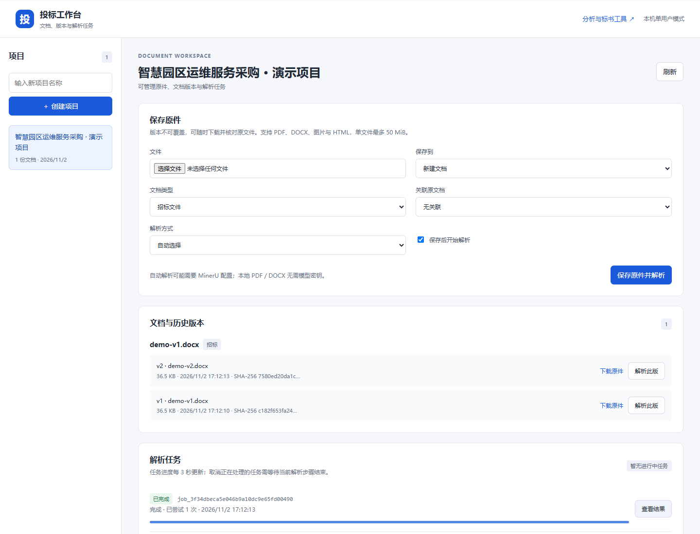
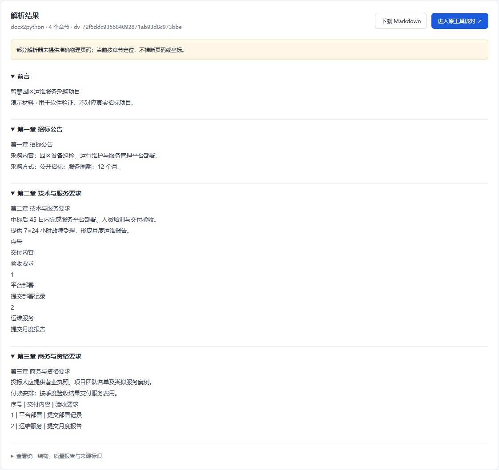
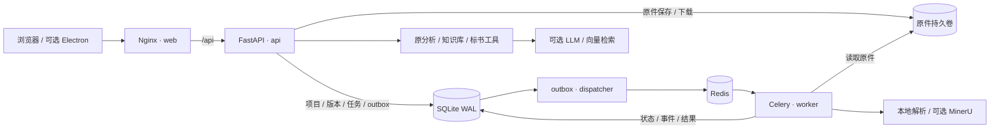

# Bid Agent · 招投标智能工作台

<div align="center">


**原件归档 · 文档版本 · 后台解析 · 条款分析 · 知识检索 · 标书草稿**

[功能特性](#功能特性) · [界面预览](#界面预览) · [技术架构](#技术架构) · [快速开始](#快速开始) · [配置说明](#配置说明) · [文档导航](#文档导航)

</div>

Bid Agent 面向招投标文档的整理、解析与辅助编写，将项目、招标原件、修订版本和解析任务集中到浏览器工作台。上传后由后台处理，刷新页面或重启容器后，仍可查看原件、任务历史和已保存的解析结果。

在文档工作台之外，项目保留了条款抽取、知识库、证据检索、目录及章节草稿工具。通过配置兼容 OpenAI 的模型接口和可选 MinerU 服务，可以继续进行智能分析与辅助编写。

> **当前版本：0.3.0。** 文档与后台解析流程已落地；条款分析和草稿生成通过原工具入口使用。正式 Word／PDF 成品导出、标书服务端版本和字段级证据闭环列入后续计划。

## 功能特性

### 项目与原件管理

- **按项目归档**：集中管理招标文件、澄清文件和附件，支持关联原文档。
- **保留历史版本**：修订稿产生新版本；同一文档重复上传相同内容时复用已有版本。
- **下载原始文件**：保留上传时的原始字节，使用 SHA-256 校验内容一致性。
- **支持多种格式**：原件存储支持 PDF、DOCX、PNG、JPEG、WEBP 和 HTML，默认单文件上限为 50 MiB。旧 `.doc` 文件需先转换为 `.docx`。

### 文档解析与后台任务

- **本地 PDF／DOCX 解析**：原生 PDF 文本和 DOCX 可在基础镜像中解析，无需模型密钥。
- **可选解析能力**：支持接入 MinerU；full 镜像提供本地 OCR、Docling 等依赖，具体能力取决于配置及模型准备情况。
- **统一解析结果**：保存正文、章节、来源版本、质量信息和统一 `ParsedDocument` 结构，支持下载 Markdown。
- **任务可恢复**：支持幂等提交、进度查询、事件历史、失败重试、取消，以及 Worker 失联后的重新处理。
- **页面与任务解耦**：关闭或刷新页面不会取消后台解析；返回项目后可以继续查看状态和结果。

### 智能分析与标书辅助

| 能力 | 当前用途 | 使用入口 |
|---|---|---|
| 招标要点抽取 | 项目概览、资格、废标、商务、技术与评分要求分析 | 原分析工具；智能分析需配置 LLM |
| 知识库管理 | 知识条目创建、编辑、导入、导出 | 原知识库工具 |
| 证据检索 | 关键词检索，可选 Chroma 向量检索与重排 | 原检索工具；向量能力需额外配置 |
| 目录与章节草稿 | 生成目录及章节初稿，辅助后续编辑 | 原标书工具 |
| 内容辅助审查 | 规则检查、原文对照和模型辅助分析 | 原审查工具 |

管理员可以从工作台的成功解析结果进入原工具核对正文。后续分析仍沿用原有入库流程，尚未与新文档版本形成字段级证据关联；生成内容需要人工核对。

### 登录与项目权限

- **本机模式**：默认只绑定 `127.0.0.1`，以单用户管理员模式使用。
- **账号模式**：开启认证后，通过用户名和密码登录，使用服务端会话和 CSRF 校验。
- **项目角色**：支持 owner、editor、viewer，控制原件、任务和结果的访问与修改。
- **旧入口保护**：认证启用后，原分析、知识库与检索接口仅管理员可用。

## 界面预览

以下为本项目真实 Docker 服务中的页面截图，使用合成演示招标文件。新安装时项目列表为空，创建项目并上传原件后即可看到对应文档与任务。

### 文档工作台

左侧切换项目，右侧保存原件、选择解析方式、查看历史版本与任务状态。



### 解析结果

按章节核对解析正文，查看来源版本、提示信息和统一结构，并下载 Markdown 或进入原工具继续分析。



## 技术架构

### 系统架构



默认部署包含 **web、api、redis、worker、dispatcher 五个服务**，只有 web 发布宿主机端口。浏览器通过同源 `/api` 访问后端，API、Worker 和 Dispatcher 共用应用镜像及业务数据卷。

任务状态与 outbox 保存在 SQLite 中，Redis 负责消息投递。消息发布失败或 Worker 失联时，Dispatcher 根据数据库记录重新投递；任务结果不依赖浏览器长连接。

### 核心技术栈

| 层级 | 技术 | 职责 |
|---|---|---|
| Web 界面 | HTML、CSS、JavaScript | 文档工作台、解析结果与原分析界面 |
| 后端 API | Python、FastAPI、Pydantic | 请求校验、登录、项目权限和业务接口 |
| 数据访问 | Repository、SQLite WAL | 项目、知识、版本、任务、事件和 outbox |
| 任务系统 | Celery、Redis、独立 Dispatcher | 消息投递、后台执行、心跳与恢复 |
| 原件存储 | LocalObjectStore、SHA-256 | 持久化原件、内容寻址和下载校验 |
| 文档处理 | pdfplumber、PyMuPDF、docx2python | 本地 PDF／DOCX 解析与结构转换 |
| 智能能力 | OpenAI 兼容接口、可选 MinerU | 条款分析、草稿生成和文档解析 |
| 可选本地 AI | Docling、OCR、Chroma、Embedding／Reranker | full 镜像中的扩展能力 |
| 部署 | Docker Compose、Nginx、DaoCloud 镜像 | 五服务运行、同源代理、健康检查与日志轮转 |
| 桌面外壳 | Electron | 打开同一网页，不单独启动 Python 后端 |

当前采用单机 SQLite，默认 API 单进程、Worker 并发为 1。PostgreSQL、S3 和多主机扩容属于后续阶段，详见[架构说明](docs/architecture/overview.md)。

## 快速开始

### 环境要求

| 项目 | 要求 |
|---|---|
| 容器环境 | Docker Engine，或启用 Linux 容器模式的 Docker Desktop |
| Compose | Docker Compose 2.24 或更新版本 |
| 网络 | 首次构建可访问 DaoCloud 镜像站和 Python 包源 |
| 使用方式 | 浏览器访问；仅运行 Docker 无需宿主机 Python 或 Node.js |

基础版可先从 4 GB 内存环境验证；本地 OCR、向量模型等完整能力需要更多资源，配置建议见[部署手册](docs/deployment/docker.md)。

### 方式一：脚本启动（推荐）

先获取项目并进入目录：

```bash
git clone https://github.com/RudyJunyu/Bid_Agent.git
cd Bid_Agent
```

Windows PowerShell：

```powershell
powershell -File scripts/start.ps1
```

也可以双击根目录的 `run.bat`。Linux／macOS：

```bash
sh scripts/start.sh
```

脚本会在 `.env` 不存在时复制配置模板，构建镜像并等待五个服务健康。Windows 已有镜像时可用 `powershell -File scripts/start.ps1 -NoBuild`。

### 方式二：手动 Docker 部署

Linux／macOS：

```bash
cp .env.example .env
docker compose up -d --build --wait --wait-timeout 180
```

Windows PowerShell：

```powershell
Copy-Item .env.example .env
docker compose up -d --build --wait --wait-timeout 180
```

已有 `.env` 时保留现有配置，仅补充所需字段。默认镜像来自 **DaoCloud**：Python 3.12 slim、Redis 7 Alpine，以及固定摘要的 Nginx 1.31.3。

| 入口 | 默认地址 |
|---|---|
| 文档工作台 | http://127.0.0.1:8080/ |
| 原分析与标书工具 | http://127.0.0.1:8080/index.html |
| API 文档 | http://127.0.0.1:8080/api/docs |
| API 就绪检查 | http://127.0.0.1:8080/api/ready |

端口由 `.env` 的 `BID_HTTP_PORT` 控制，以启动终端输出为准。本次本机验证因 8080 无法绑定，使用了 **http://127.0.0.1:18089/**；新部署模板默认仍为 8080。

### 启动成功后的终端

下面是本机实际启动成功后的输出节选，省略了镜像、命令和动态时间列。启动脚本只有在健康检查通过后才会打印 `READY`。

```text
SERVICE       STATUS                    PORTS
api           Up ... (healthy)          8000/tcp
dispatcher    Up ... (healthy)          8000/tcp
redis         Up ... (healthy)          6379/tcp
web           Up ... (healthy)          127.0.0.1:18089->8080/tcp
worker        Up ... (healthy)          8000/tcp

============================================================
  BID AGENT | READY
  web / api / worker / dispatcher / redis: healthy
  Workspace : http://127.0.0.1:18089/
  API docs  : http://127.0.0.1:18089/api/docs
  Next: Create project -> Upload original -> View parse result
  Logs: docker compose logs -f --tail 100 api worker dispatcher
============================================================
```

### 完成第一次解析

1. 在左侧输入项目名称，点击“创建项目”。
2. 选择 PDF 或 DOCX 原件。无需外部服务的体验请选择“本地 PDF 文本”或“本地 DOCX”；自动策略可能选择 MinerU。
3. 点击“保存原件并解析”，在任务列表查看状态。此时可以刷新或离开页面。
4. 完成后点击“查看结果”，核对章节正文；使用“下载原件”或“下载 Markdown”保存文件。
5. 上传修订稿时，在“保存到”中选择原文档，系统新增 v2 并保留 v1。澄清和附件可设置类型及关联文档。
6. 管理员需要继续分析时，点击“进入原工具核对”。

## 配置说明

配置模板位于 [.env.example](.env.example)。修改后执行 `docker compose up -d --force-recreate --wait --wait-timeout 180`，让容器重新读取配置。

### 常用环境变量

| 变量 | 默认值 | 说明 |
|---|---|---|
| `BID_BIND_HOST` | `127.0.0.1` | 网页监听地址 |
| `BID_HTTP_PORT` | `8080` | 网页和同源 API 的访问端口 |
| `BID_IMAGE_TARGET` | `runtime` | `runtime` 基础版；`full` 安装本地 AI 相关依赖 |
| `BID_MAX_UPLOAD_MB` | `50` | 单文件大小限制，单位 MiB；调整时同步修改 Nginx 上限 |
| `BID_AUTH_ENABLED` | `false` | 是否启用账号登录和项目角色权限 |
| `BID_ADMIN_USERNAME` | 空 | 首次启用认证时创建的管理员用户名 |
| `BID_ADMIN_PASSWORD` | 空 | 首次管理员密码，长度 12–256 字符 |
| `BID_COOKIE_SECURE` | `false` | 浏览器使用 HTTPS 时设置为 `true` |
| `BID_REDIS_URL` | `redis://redis:6379/0` | 后台任务消息代理地址 |
| `LLM_API_KEY`／`LLM_MODEL_ID`／`LLM_BASE_URL` | 空 | 智能分析使用的模型凭据、模型 ID 和接口地址 |
| `MINERU_API_TOKEN` | 空 | 远程 MinerU 解析凭据 |
| `BID_VECTOR_STORE_ENABLED` | `false` | 是否启用向量检索能力 |
| `RERANKER_ENABLED` | `false` | 是否启用本地重排模型 |

镜像地址通过 `PYTHON_IMAGE`、`NGINX_IMAGE`、`REDIS_IMAGE` 覆盖。全部参数、模型缓存及迁移方式见 [Docker 部署手册](docs/deployment/docker.md)。

### 模型与解析能力

**本地解析无需密钥。** 如需智能分析，在 `.env` 中填写供应商提供的兼容接口配置，将下方占位值替换为实际值：

```dotenv
LLM_API_KEY=your-api-key
LLM_MODEL_ID=your-model-id
LLM_BASE_URL=https://your-provider.example/v1
```

使用远程 MinerU 时配置 `MINERU_API_TOKEN`。本地 OCR、Docling、Chroma 等能力需选择 full 镜像，按需启用配置并准备模型；仅切换镜像目标不会自动启用全部能力。

### 团队账号与项目角色

```dotenv
BID_AUTH_ENABLED=true
BID_ADMIN_USERNAME=admin
BID_ADMIN_PASSWORD=replace-with-a-unique-password
```

首次启动会创建管理员。管理员已存在后，修改环境变量不会重置其密码。通过 HTTPS 提供团队访问时，同时设置 `BID_COOKIE_SECURE=true`。

| 角色 | 查看原件与结果 | 上传、解析、取消与重试 | 管理项目成员 | 原分析工具 |
|---|---|---|---|---|
| 管理员 | 全部项目 | 允许 | 允许 | 允许 |
| owner | 自己的项目 | 允许 | 允许 | 不开放 |
| editor | 已授权项目 | 允许 | 不允许 | 不开放 |
| viewer | 已授权项目 | 不允许 | 不允许 | 不开放 |

账号创建和成员分配操作见[权限与接口说明](docs/implementation/b01-b06.md#8-权限与接口)。当前尚无独立账号管理页面、密码找回和统一业务审计。

## 数据保存与日常运维

### 持久化数据

| 默认命名卷 | 保存内容 |
|---|---|
| `bid-agent_bid-data` | SQLite、原件 objects、可选 Chroma 数据 |
| `bid-agent_queue-data` | Redis AOF 消息持久化 |
| `bid-agent_model-cache` | 模型下载缓存 |

卷名前缀随 Compose 项目名变化。宿主机 `storage/` 用于本地开发，与 Docker 命名卷不是同一位置。

`docker compose down` 保留数据卷；**需要保留数据时不要执行 `docker compose down -v`**。

### 常用命令

```bash
# 查看五个服务的状态
docker compose ps

# 跟踪业务日志
docker compose logs -f --tail 100 api worker dispatcher

# 停止与再次启动
docker compose stop
docker compose up -d --wait --wait-timeout 180

# 检查反向代理配置
docker compose exec web nginx -t
```

宿主安装 Python 3.11+ 后，可以使用无需第三方包的冷备份脚本：

```bash
python scripts/backup_data.py
```

脚本短暂停止业务写入服务，备份数据库和原件、生成哈希清单，再恢复此前运行的服务。备份不包含 `.env`、模型缓存和 Redis 卷；恢复及升级步骤见[部署手册](docs/deployment/docker.md#6-备份与恢复)。

## 项目结构

```text
Bid_Agent/
├── backend/bid_agent/
│   ├── main.py                 # FastAPI 入口与数据库初始化
│   ├── api/routes/             # 登录、文档工作台与原业务接口
│   ├── repositories/           # 项目、知识、权限、版本、任务与 outbox
│   ├── schemas/                # 输入模型与 ParsedDocument
│   ├── services/               # 后台解析与分析流程
│   ├── parsing/                # PDF／DOCX／其他解析器及策略
│   ├── analysis/               # 规则、Prompt 与专项抽取
│   ├── rag/                    # 关键词与可选向量检索
│   ├── generation/             # 目录及章节草稿生成
│   ├── review/                 # 内容辅助审查
│   ├── infrastructure/         # 原件存储、数据库与外部服务
│   ├── core/                   # 环境配置、身份与会话
│   ├── worker.py               # Celery 解析任务消费者
│   └── dispatcher.py           # 消息发布及失联任务恢复
├── frontend/web/               # 浏览器工作台与原分析工具
├── frontend/desktop/           # 可选 Electron 外壳
├── deploy/                     # Dockerfile 与 Nginx 配置
├── requirements/               # 基础／完整依赖与锁文件
├── scripts/                    # 启动、备份与索引维护
├── tests/                      # 已有回归测试
├── docs/                       # 架构、部署、实施、验证及页面截图
├── storage/                    # 本地开发数据
├── compose.yaml                # 五服务部署配置
├── pyproject.toml
└── .env.example
```

## 本地开发

推荐使用与容器一致的 **Python 3.12**；项目声明支持 Python 3.11／3.12。

```bash
python -m venv .venv
# Windows: .venv\Scripts\activate
# Linux / macOS: source .venv/bin/activate
python -m pip install -r requirements.txt -r requirements/dev.in
python -m pip install --no-deps -e .
python -m pytest -q
ruff check backend tests scripts
```

推荐先使用 Compose 调试完整链路。宿主机分别运行 API、Worker 和 Dispatcher 时，须配置一致的数据库、原件目录及 Redis 地址，并先完成 API 初始化；仅启动 uvicorn 不会执行后台解析任务。具体启动方式见[本地调试说明](docs/deployment/docker.md#9-本地调试后台任务)。

需要桌面窗口时，在服务已启动的前提下执行：

```bash
cd frontend/desktop
npm ci
npm start
```

Electron 默认连接 `http://127.0.0.1:8080`，使用其他端口时通过 `BID_WEB_URL` 指定工作台地址。

## 开发进度

| 阶段 | 内容 | 状态 |
|---|---|---|
| B01–B03 | Repository、授权原件存储、文档版本与澄清附件关系 | 已实现 |
| B04–B06 | 任务表、outbox、Worker、后台解析与统一结果结构 | 已实现 |
| 配套工作台 | 登录与项目角色、文档列表、任务进度、结果和下载 | 已实现 |
| B07–B10 | 字段级证据、PostgreSQL 迁移、企业资产与检索评测 | 计划中 |
| B11–B13 | 标书／章节版本、证据约束生成与响应矩阵 | 计划中 |
| B14–B16 | 正式 DOCX／PDF 导出、审查审批、生产恢复与容量验收 | 计划中 |

本地验证已覆盖 34 项回归测试，以及真实 Docker 队列、浏览器操作、容器重建、Redis 中断和 Worker 强制终止后的恢复。测试范围及保留在本地的测试文件说明见[验证记录](docs/verification.md)。

当前解析结构以章节为主要粒度；未提供真实页码或坐标的解析器会保留空值并提示。扫描件、复杂表格和真实 LLM／MinerU 的质量仍需业务样本评测；full 镜像的完整推理能力尚未实测验收。

## 常见问题

| 问题 | 处理方式 |
|---|---|
| 没有模型密钥能用吗？ | 可以管理项目、原件和版本，并使用本地 PDF 文本／DOCX 解析；智能分析另需 LLM 配置。 |
| 页面能打开，任务一直排队？ | 检查 worker、dispatcher、redis 是否 healthy，再查看任务服务日志。 |
| 8080 端口被占用？ | 修改 `.env` 中的 `BID_HTTP_PORT`，重新创建服务，按终端给出的地址访问。 |
| 自动解析提示 MinerU 错误？ | 核对凭据；原生 PDF／DOCX 可显式切换到对应本地解析方式。 |
| 点了取消为何仍在处理？ | 运行中的解析需等待当前调用结束再丢弃结果；取消不是立即杀死进程。 |
| 重建容器后找不到数据？ | 检查 Compose 项目名及命名卷是否改变，确认没有删除数据卷。 |
| 能直接导出正式 Word／PDF 标书吗？ | 当前支持原件及 Markdown 下载，正式排版导出列入后续阶段。 |

## 文档导航

| 文档 | 内容 |
|---|---|
| [完整项目实施方案](docs/project-completion-plan.md) | 最终业务目标、阶段依赖与验收要求 |
| [B01–B06 实施说明](docs/implementation/b01-b06.md) | 数据模型、状态机、接口、权限与实现边界 |
| [架构梳理](docs/architecture/overview.md) | 模块职责、新旧业务链路及技术债 |
| [Docker 部署手册](docs/deployment/docker.md) | 配置、登录、迁移、备份恢复与排错 |
| [验证记录](docs/verification.md) | 已执行检查、故障验证及尚未覆盖范围 |

README 的信息组织参考了 [BidMaster Pro](https://github.com/guangshu100/BidMaster-Pro)；上文功能、部署方式和截图均对应本仓库。
