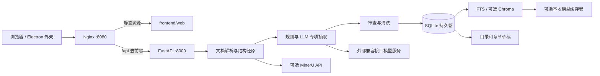

# 项目架构梳理

基于仓库代码审查；本次改造范围为工程结构与部署基础，不将计划功能计为已交付功能。

## 1. 原工程情况

原根目录有 22 个 Python 文件，业务 API、解析、Prompt、SQLite、模型访问和 Agent 示例混放。`bid_parser_api.py` 约 1,818 行，`bid_database.py` 约 2,806 行，Electron `renderer.js` 约 3,581 行。没有测试目录、Dockerfile、Compose 或 CI。

原运行方式是 Windows 脚本安装 Python 和 npm 依赖，再由 Electron 寻找并启动本机 FastAPI。数据库相对 Python 文件定位，Chroma 相对工作目录定位，目录移动会改变数据位置。原 `.chroma` 数据和迁移 ZIP 已进入版本管理。

业务并非从零开始：已有文档分章节、规则抽取、模型抽取、审查、SQLite 知识库、FTS 与可选向量检索，以及目录／章节草稿生成。但“有表”“有按钮”“有接口”不等于完整业务闭环。

## 2. 本次实际运行架构

只有 `web` 发布宿主机端口。浏览器默认请求当前站点 `/api`，部署到服务器后不会误连浏览器所在机器的 8000 端口。Nginx 禁用响应缓冲，并保留长请求读取超时，以支持原有 NDJSON 流。

FastAPI 使用单 worker。数据库仍为 SQLite；完整版本地向量索引仍为 Chroma PersistentClient。不能通过增加 API 容器副本直接获得安全的分布式写入能力。

## 3. 各层职责与边界

| 目录 | 当前职责 | 后续约束 |
|---|---|---|
| `api/routes` | 参数、HTTP 返回、文档上传、项目与知识库入口 | 新业务规则进入 service；路由不写新 SQL |
| `schemas` | Pydantic 请求／响应 | 输入上限、业务枚举、版本兼容集中定义 |
| `services` | 抽取任务组织、阶段顺序、回退策略 | 后续抽成可恢复工作流，不绑定 HTTP 连接 |
| `parsing` | 文档格式识别、PDF／Word 解析、图像信息 | 产出统一 ParsedDocument，不直接调用页面逻辑 |
| `analysis` | 规则候选、Prompt、JSON Schema、清洗、预筛 | 证据引用与业务字段分开，不将推测写成事实 |
| `rag` | 章节召回、关键词／向量融合、重排 | 查询必须携带项目／租户范围；索引允许重建 |
| `generation` | 规则目录、证据上下文、章节初稿 | 后续加版本、待补材料、响应矩阵及导出 |
| `review` | 关键词覆盖、原文对照、溯源评分 | 评分是辅助信号，不表示法律或投标合规结论 |
| `infrastructure` | SQLite 访问、LLM／MinerU／SerpAPI | SDK 和外部协议不外溢到领域模型 |
| `core` | 项目路径、环境变量、模型名称映射 | 不保留请求级全局可变模型配置 |
| `agents` | 顺序 Plan-and-Solve 示例 | 目前不负责主业务流程，不宣称已接入主链路 |
| `frontend/web` | 原界面浏览器化 | 后续按项目／知识库／生成／审查拆组件与状态 |
| `frontend/desktop` | 可选网页窗口 | 无本地 Python 拉起、无 Node 渲染权限 |

这是模块化单体的第一步，尚未形成严格的领域隔离。`database.py` 仍同时包含建表、数据访问和部分业务清洗；`analysis/service.py` 与 `services/analysis_workflow.py` 存在同步／流式流程重复；`documents.py` 的流式路由仍较大。后续按方案拆解，避免用“重命名目录”掩盖技术债。

## 4. 实际数据链路

1. 上传文件进入临时目录。现阶段处理结束后删除临时原件，数据库只保存解析正文、分片和文件元数据，尚无持久化原件下载。
2. 解析策略读取样本页判断原生、扫描或混合 PDF；按策略走 pdfplumber、MinerU 或可选解析器。
3. 文本转 Markdown，重建标题与章节，补充表格、图像与层级信息。
4. 规则先生成项目画像和章节树，再召回商业、技术、资格、评分相关候选。
5. 轻量模型可预筛资格和废标片段；主模型执行专项抽取。Markdown 为默认，强结构化模式为选项。
6. 清洗重复条目、金额日期信息和模块输出，形成 SQLite 记录。
7. 分片进入 SQLite FTS；启用向量时另写 Chroma，`chunk_embeddings` 记录映射。向量失败可回退关键词检索。
8. 从项目条款和分片生成目录及章节草稿；浏览器编辑后可导出 Markdown。

原 NDJSON 消息包含 `status`、`parsed`、`field_delta`／`field_done`、`done`／`error` 等实际代码定义的事件。它不是持久消息队列；浏览器断线后暂不支持从已确认偏移恢复。详见代码与 API 清单，不把 HTTP 流视为后台任务系统。

## 5. 本次兼容与行为变化

| 项目 | 处理 |
|---|---|
| 原有业务接口路径 | 保留，测试检查原 25 个业务路由；健康检查保留并新增 `/ready` |
| Docker 对外路径 | `/api/` + 原接口；例如 `/api/projects` |
| ASGI 入口 | `bid_parser_api:app` 改为 `bid_agent.main:app` |
| 原 Python import | 全部改为 `bid_agent.*` 包路径，不保留根目录兼容空壳 |
| 数据路径 | 环境变量统一控制，不随命令工作目录变化 |
| 模型选择 | 改为每次请求解析并传给客户端，不修改全局环境 |
| 生命周期 | 启动初始化数据库改用 FastAPI lifespan |
| CORS | 默认同源，跨源通过明确列表开启 |
| 文件限制 | 默认 50 MiB；空文件返回 422，超限返回 413 |
| 服务器文件路径 | 默认关闭本地路径读取／任意 output_dir；仅可信本机可显式打开 |
| 向量默认值 | 基础版关闭，需要完整依赖与配置后开启 |
| Electron | 连接 Docker 网页，无后端自启动职责 |
| 已有索引 | 原样移动到 `storage/chroma`，不自动写入 Docker 卷 |

服务器文件路径默认关闭是有意的接口行为收紧；HTTP(S) 文件地址仍走现有远程解析流程。公开服务前仍需补远程地址域名限制、配额、解析隔离和鉴权。

## 6. 后续分层目标

依赖方向目标：`HTTP / Worker → Application Service → Domain / Repository Protocol → Infrastructure 实现`。

先将数据库拆成 `repositories/projects.py`、`documents.py`、`knowledge.py`、`generation.py`，再引入 PostgreSQL 与 Alembic。解析器统一接口，Workflow 输出标准事件，由 HTTP 和任务 Worker 共用。

前端以 Vue 3 + TypeScript + Vite 为推荐升级方案；当前界面无需等重写才能容器运行。优先抽 API 客户端、项目状态与生成编辑器，再替换大文件，保持路径和业务结果可回归。

详细旧文件到新模块路径见 [module-mapping.json](module-mapping.json)。实施先后顺序和完成定义见 [完整实施方案](../project-completion-plan.md)。
