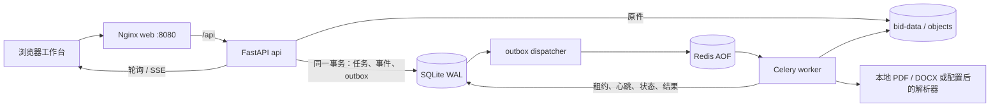
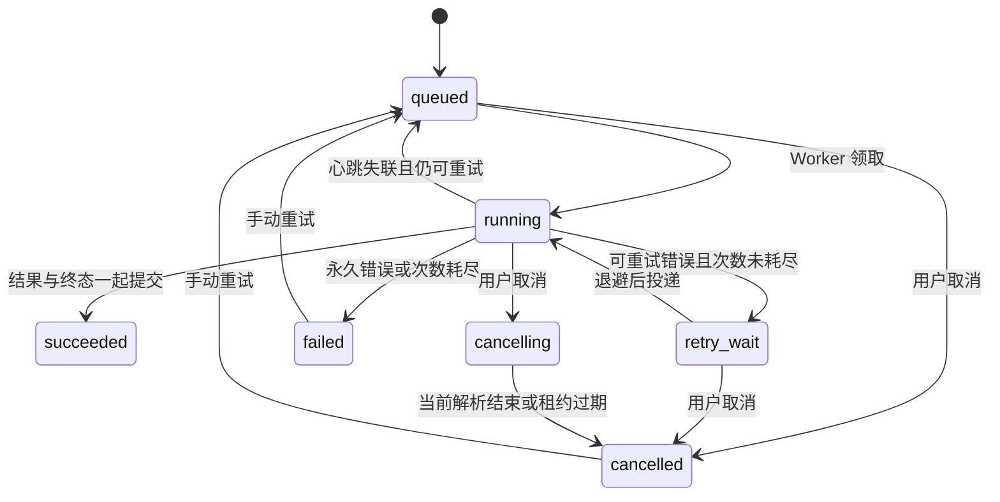

# B01–B06 实施说明与验收手册

版本：0.3.0；日期：2026-11-02。本轮范围是项目与知识库数据层拆分、原件版本、可恢复解析任务、统一解析结构，以及可操作的文档工作台。B07–B16 继续按[完整方案](../project-completion-plan.md)推进。

## 1. 已实现的业务路径

创建项目 → 保存招标原件 → 创建不可覆盖的版本 → 提交解析任务 → 后台处理 → 查看进度、结果与事件 → 下载原件或 Markdown。关闭页面不取消后台任务；重新进入项目可查看历史任务。同一逻辑文档上传不同内容产生 v2，历史 v1 和引用它的解析结果保持原样。澄清文件／附件可关联当前项目的原文档。

工作台是默认首页 `workspace.html`。旧 `index.html` 保留分析、知识库和标书工具；管理员可从成功解析结果进入旧工具核对正文。旧工具的进一步分析仍沿用原有项目入库流程，尚未与新文档版本建立字段级证据关联；这是 B07 的工作。

## 2. 工作包与代码落点

| 编号 | 交付 | 关键文件 |
|---|---|---|
| B01 | 项目／知识库 SQL 操作迁至 Repository；旧导入保留兼容委托 | `repositories/projects.py`、`knowledge.py` |
| B02 | 流式保存、格式验证、SHA-256、原子写入、授权下载 | `infrastructure/object_store.py`、`api/routes/workspace.py` |
| B03 | 项目内逻辑文档、不可覆盖版本、澄清附件关系 | `repositories/workspace.py`、`platform.py` |
| B04 | 事务任务表、outbox、Redis、Celery、租约与恢复 | `repositories/jobs.py`、`dispatcher.py`、`worker.py` |
| B05 | HTTP 202 提交，Worker 调用解析服务，持久化状态／结果／事件 | `services/parse_jobs.py`、`services/document_parser.py` |
| B06 | 所有解析器进入统一 ParsedDocument 校验和保存路径 | `schemas/documents.py` |
| 配套 | 登录、会话、项目角色、CSRF、文档工作台 | `core/security.py`、`api/routes/auth.py`、`frontend/web/workspace.*` |

B01 并未把整个历史数据库模块清空：旧建表、分析入库和文本清洗仍在 `infrastructure/database.py`。本轮为 SQLite 仓储实现；SQLAlchemy／Alembic／PostgreSQL 属于 B08。

## 3. 部署与调用关系



共五个服务，只有 web 发布端口。API、Worker、Dispatcher 使用同一个应用镜像和同一数据卷；Redis 使用单独 queue-data 卷。Redis 负责投递，SQLite 中的任务／outbox 是恢复依据。默认 Worker 并发为 1；不支持用网络文件系统共享 SQLite 做多主机扩容。

## 4. 数据与事务约束

| 表 | 主要用途与约束 |
|---|---|
| `users`／`sessions` | 用户名唯一；scrypt 密码；仅保存会话 token 的 SHA-256 |
| `project_members` | `(project_id,user_id)` 唯一；owner／editor／viewer |
| `documents` | 项目内逻辑文档；tender／clarification／attachment；父文档关系 |
| `document_versions` | 原件名、存储键、类型、大小、SHA-256、上传者；文档内版本号及哈希唯一 |
| `jobs` | 解析选项、状态、幂等键、请求摘要、尝试次数、租约、进度、错误 |
| `parsed_documents` | 每个成功 job 唯一一条结果，绑定源文档版本及解析器版本 |
| `job_events` | 全局递增 sequence；项目授权后按任务和游标读取 |
| `outbox_events` | 消息发布状态、可用时间、发布租约与错误类型 |
| `platform_migrations` | 当前追加建表版本为 1，记录应用时间 |

新 schema 在 API 启动时追加创建，保留历史业务表和 ID；Worker、Dispatcher 等 API 就绪后启动。连接启用外键；涉及版本序号、任务领取和 outbox 的写操作使用 `BEGIN IMMEDIATE`，等待锁超时 30 秒。启动启用 WAL。

任务、初始事件、outbox 在同一数据库事务提交。提交失败时三者一起回滚。Redis 发布失败不会把任务标成成功。原件先落文件再写元数据；如果后续事务失败，可能遗留无引用内容对象，这些对象不被 API 列出。尚未提供自动垃圾回收，不能按单个项目删除文件，因为多个版本可能共享内容。

升级前冷备整个 `/app/storage`。旧数据没有原件时不能从解析文字反向恢复原 PDF／DOCX；需要用户重新上传。开启认证后，既有未分配成员的项目默认由管理员查看，再添加明确的项目成员。

## 5. 原件存储与边界

- 默认单文件最大 50 MiB；上传时逐块计数，超限 413。Nginx 总请求体上限 52 MiB。
- 文件写入同一文件系统的临时文件，经 fsync、内容检查后原子替换至 `objects/哈希前两位/完整哈希.后缀`。
- 支持 PDF、DOCX、PNG、JPEG、WEBP、HTML。校验 PDF 文件头、DOCX 必要条目／条目数量／解压体积／路径、图片真实格式／像素量。不是完整的恶意文档扫描器。
- 旧 `.doc` 须先转成 `.docx`；扫描件、图片和 HTML 的解析依赖对应解析器／凭据。
- 原件下载检查用户和项目权限，以附件方式返回，不直接公开对象路径。Worker 解析前再次核对 SHA-256。
- LocalObjectStore 已实现 ObjectStore 协议。S3／MinIO 后端尚未实现；本轮使用持久卷中的本地对象目录。

## 6. 任务状态、重试与取消



1. 创建请求必须带 `Idempotency-Key`。同一项目中相同键与相同版本／选项返回同一任务，不同请求复用相同键返回 409。
2. 默认最多尝试 3 次；可重试错误包括超时、连接错误及部分服务不可用状态。失败后按退避时间重新写 outbox。手动重试保留尝试历史，并增加 3 次尝试预算。
3. 任务租约为 60 秒，Worker 每 15 秒续约。Dispatcher 约每秒检查；失联任务恢复排队或结束为失败。每次领取获得新 token，旧 Worker 无法覆盖新任务尝试的结果。
4. outbox 发布租约为 30 秒；发布异常 10 秒后重试。已发布但 120 秒内始终未被领取的可执行任务重新投递，补偿 Redis 消息丢失。
5. 取消排队任务立即生效；运行中进入 cancelling，当前解析调用结束后丢弃结果。取消不是立即杀进程，已经发往外部服务的调用可能仍消耗资源。
6. Celery soft/hard 时间限制分别为 1900／2000 秒；Redis 可见性超时 2400 秒。重复投递必须先通过数据库领取，不重复写成功结果。
7. 页面每 3 秒读取任务列表；事件 API 支持 `after`，SSE 支持 `Last-Event-ID`。权限或会话失效时 SSE 结束。

## 7. 解析结果契约

`schema_version=1.0`；`parser_version=bid-parser-v2`。主要字段为 `document_version_id`、`source_sha256`、`parse_method`、`markdown`、`sections`、`blocks`、`quality` 和 `warnings`。`blocks` 可含 `type=section|table`；表格块在 pdfplumber `find_tables` 可用时带 `bbox`，章节块仍通常无坐标。

当前 block 粒度为章节，包含稳定 ID、章节序号、层级路径、正文、解析器 metadata；table／image 信息保留在已有 metadata／Markdown 中。Schema 为 paragraph／table／image 和 bbox 预留字段，但本轮没有把每个解析器转换为精确的逐段／逐表／逐图块。无真实页码或坐标时保持 null 并提示按章节定位，不推测物理坐标。

PDF 与 DOCX 的统一管线有实际本地解析测试。扫描件／远程 MinerU 走同一结构归一化代码，但未进行付费远程调用和真实 OCR 质量验收。复杂表格、跨页关联、字段级证据和质量基线继续按 B07 及样本评测计划推进。

## 8. 权限与接口

默认 `BID_AUTH_ENABLED=false` 为本机单用户管理模式；团队使用必须开启认证。初次启动以环境变量创建管理员，密码长度 12–256；管理员已存在时，修改环境变量不会重置密码。

| 角色 | 项目读取／下载／结果 | 上传／解析／取消／重试 | 管理成员 | 旧分析／知识库接口 |
|---|---|---|---|---|
| 管理员 | 全部 | 全部 | 全部 | 允许 |
| owner | 自己项目 | 允许 | 允许 | 禁止 |
| editor | 已加入项目 | 允许 | 禁止 | 禁止 |
| viewer | 已加入项目 | 禁止 | 禁止 | 禁止 |
| 未加入成员 | 不可见（404） | 禁止 | 禁止 | 禁止 |

会话 Cookie 为 HttpOnly、SameSite=Strict，12 小时有效；写请求需 `X-CSRF-Token`。HTTPS 时设置 `BID_COOKIE_SECURE=true`。旧接口统一限制管理员，防止从旧项目／下载／检索入口绕开新项目权限。尚无密码找回、成员删除、统一全业务审计、单点登录及租户计费。

下列均为后端路径；经 Nginx 时添加 `/api` 前缀。

| 方法与路径 | 功能 |
|---|---|
| GET `/auth/status`、`/auth/me` | 认证模式、当前用户、CSRF token |
| POST `/auth/login`、`/auth/logout` | 登录／退出 |
| POST `/auth/users` | 管理员创建账号 |
| GET／POST `/v1/projects` | 项目列表／创建 |
| POST `/v1/projects/{id}/members` | owner／管理员添加或调整成员 |
| GET／POST `/v1/projects/{id}/documents` | 文档及版本列表／保存原件 |
| GET `/v1/document-versions/{id}/download` | 授权下载原件 |
| POST `/v1/document-versions/{id}/parse-jobs` | 创建任务，202 + Location |
| GET `/v1/projects/{id}/jobs` | 最近任务，默认 100，最多 200 |
| GET `/v1/jobs/{id}`、`/result` | 状态／成功结果 |
| GET `/v1/jobs/{id}/events?after=N`、`/stream` | 事件补读／SSE |
| POST `/v1/jobs/{id}/cancel`、`/retry` | 取消／重试 |

创建账号示例：管理员先在工作台登录，在同源浏览器控制台执行（密码请换成实际值）：

```javascript
const { csrf_token } = await fetch('/api/auth/me').then(r => r.json());
await fetch('/api/auth/users', {
  method: 'POST',
  headers: { 'Content-Type': 'application/json', 'X-CSRF-Token': csrf_token },
  body: JSON.stringify({ username: 'bid_editor', password: 'REPLACE_WITH_A_UNIQUE_PASSWORD', is_admin: false })
}).then(r => r.json());
```

然后在工作台“项目成员”中分配 editor 或 viewer。API 文档给出完整字段约束。当前没有独立账号管理页面。

## 9. 验收操作

```bash
python -m pytest -q
docker compose up -d --build --wait --wait-timeout 180
docker compose ps
docker compose exec web nginx -t
```

本轮新增及修改的测试文件与验证脚本按要求保留在本地，不随本次提交交付。34 项测试及真实队列、浏览器、故障恢复的执行记录见验证文档；仓库原有测试仍保留。

持久化复验：先在独立测试部署中通过页面创建项目、上传 v1／v2 并等待解析成功，下载原件并记录哈希、任务和结果。随后重建容器：

```bash
docker compose up -d --force-recreate --wait --wait-timeout 180
```

重新进入项目，核对两个版本及成功任务仍存在、下载原件哈希不变、解析正文一致；另通过页面验证取消／重试、结果下载及刷新。服务实测与截图见 [verification.md](../verification.md) 和 [README](../../README.md)。

## 10. 后续顺序

先完成 B07：将现有六类要求输出收敛到校验 Schema，引用本轮文档版本／block ID，建立人工确认与冲突处理。随后 B08 迁移 PostgreSQL／Alembic 并演练回滚。B09–B16 才进入企业资产、权限检索、标书版本、生成约束、响应矩阵、正式 DOCX／PDF 导出和生产故障／容量验收。
