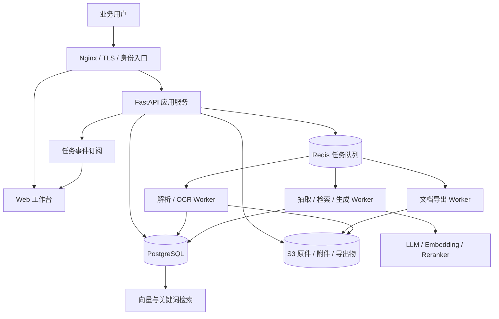
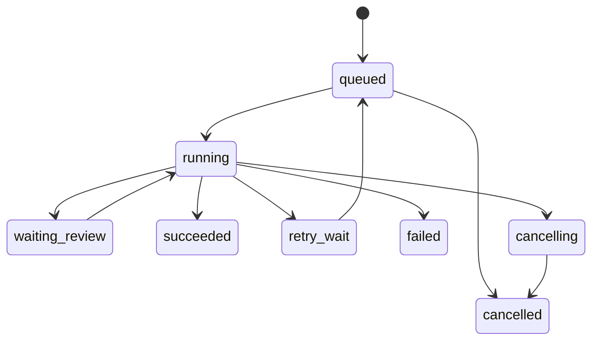

# 招投标智能体完整实施方案

版本：2026-11-02，更新至 0.3.0。B01–B06 的实现与验收边界见 [实施说明](implementation/b01-b06.md)。本文中的“建议”“待开发”“目标指标”继续属于后续工作；B07–B16 尚未实施。

## 1. 项目最终要交付什么

目标是完成“招标文件进入系统 → 证据可追溯的要求清单 → 企业材料匹配 → 可编辑的标书 → 人工审查 → 可交付文件”的业务闭环。

建议先聚焦一个明确场景：**中文服务类／货物类投标，单个企业团队使用，PDF／DOCX 招标文件，输出技术标和商务响应初稿**。工程量清单自动报价、造价计算、电子签章、各省投标平台自动提交暂不纳入首版；这些能力依赖专用数据、规则和平台适配，应独立立项。

最终交付至少包含：可部署镜像、源代码、数据库迁移、环境模板、运维手册、用户手册、真实样本评测报告、备份恢复演练记录，以及可追踪到任务与提交的验收清单。

### 首个业务版本的完成定义

1. 一个项目可管理多份招标文件、附件及澄清文件，并保留所有版本。
2. 解析后展示页码、标题、表格和原文片段；失败能解释、重试或人工替换。
3. 项目概览、资格、废标、商务、技术、评分六类数据能人工确认并保存。
4. 每条重要要求关联来源文件版本和证据，不把模型生成描述当作原文。
5. 企业资质、人员、财务、业绩及方案素材可上传、查询、标注有效期。
6. 目录和章节草稿可编辑、保存版本；刷新页面不会丢失工作。
7. 商务／技术响应矩阵可追踪“要求—证据—章节—审核状态”。
8. 可导出排版稳定的 DOCX，必要时转 PDF；缺失证据和人工待办随成果一起输出。
9. 用户权限、操作审计、任务恢复、部署升级、数据恢复均有验证记录。
10. 由投标业务人员完成至少 3 个真实脱敏项目的全流程试用与签字确认。

## 2. 现状与差距

| 能力 | 当前代码证据 | 完成判断 | 首版必须补齐 |
|---|---|---|---|
| PDF／DOCX 解析 | `parsing/document_parser.py`、`strategy.py` | 原件、版本与后台解析已落地 | 复杂表格、扫描件真实样本评测 |
| 扫描件／图片理解 | MinerU、可选 OCR、`image_analysis.py` | 路径已有，依赖外部配置 | OCR 质量阈值、页级回退、模型缓存管理 |
| 项目画像及专项抽取 | `analysis/`、`services/analysis_workflow.py` | 基础能力已有 | 统一结构模型、跨版本合并、字段级置信与来源 |
| 结构化入库 | SQLite 业务表和转换函数 | 已有，但 Markdown 清洗参与业务转换 | 模式迁移、标准化校验、结构化作为权威数据 |
| 证据检索 | SQLite FTS、可选 Chroma 与重排 | 已有 | 权限过滤、召回评测、索引版本与重建任务 |
| 知识库 | 通用 `knowledge_entries` CRUD | 可用原型 | 真正附件、结构化资产、有效期和授权范围 |
| 企业实体专表 | companies 等建表语句 | 不能因建表认定闭环完成 | 路由、业务服务、页面、专表同步与校验 |
| 目录生成 | `generation/outline.py` | 规则目录已有 | 模板、排序、目录版本、评分点覆盖检查 |
| 章节生成 | `generation/section_writer.py` | 草稿已有 | 持久化、引用、事实约束、逐章重写与版本比较 |
| 内容审查 | `review/content_review.py` | 规则与模型辅助已有 | 响应矩阵、一致性规则、人工审批、闭环状态 |
| 成品导出 | 浏览器 Markdown 下载 | 不满足正式标书交付 | DOCX 样式模板、页码、目录、表格和 PDF |
| 长任务 | 解析接入 Celery／Redis／outbox；旧分析保留原流程 | 解析支持幂等、恢复、取消、重试、事件补读 | 抽取／生成／导出接入后台任务 |
| 身份与权限 | users／sessions／project_members，旧接口限管理员 | 登录和项目角色骨架已实现 | 账号生命周期、统一审计和生产加固 |
| 工程部署 | 本次新增 Docker、测试与 CI | 基础完成 | 生产配置、版本制品、监控及恢复演练 |
| 辅助投标决策 | 原文档规划 | 待开发，首版可后置 | 可解释规则评估，避免无依据“胜率预测” |

特别注意：原文件 `file_path` 记录并不等于原件已持久化；目录和章节存在于浏览器工作状态并不等于后台版本已保存；Chroma 中有向量不等于能恢复完整项目数据库。

## 3. 框架和组件选择

### 3.1 分阶段选择

| 层 | 本次实际交付 | 团队版推荐目标 | 采用原因 |
|---|---|---|---|
| 前端 | 静态 HTML／CSS／JavaScript | Vue 3 + TypeScript + Vite + Pinia | 复杂表单、表格、章节编辑拆组件，类型化接口 |
| 后端 | FastAPI + Pydantic | 保留 FastAPI，统一应用服务与仓储 | 已有大量 Python 文档和 AI 能力，减少迁移成本 |
| 数据库 | SQLite | PostgreSQL + SQLAlchemy 2 + Alembic | 并发事务、约束、版本迁移、权限字段 |
| 任务系统 | 解析已接入 Celery + Redis + outbox；旧分析仍请求内执行 | Celery + Redis | 解析／OCR／生成可重试、独立并发和超时 |
| 文件存储 | 原件按内容哈希写入持久卷 | S3 兼容存储，开发可用 MinIO | 原件、解析中间件、附件、导出物独立持久化 |
| 向量检索 | Chroma 可选 | 先保持接口；验证后选 PostgreSQL pgvector | 避免同时永久维护两个向量真源，统一权限过滤 |
| 关键词检索 | SQLite FTS5 + 回退评分 | PostgreSQL 检索／中文分词，必要时再独立搜索引擎 | 先以召回评测决定，不先堆组件 |
| LLM 接入 | 自有 OpenAI 兼容适配层 | 保留，增加能力与用量记录 | 模型供应商可替换，集中超时、重试、结构校验 |
| Agent 编排 | 现有服务函数与独立示例 | 显式状态机优先 | 招投标流程需要可复核的确定步骤 |
| 文档导出 | Markdown | python-docx／模板引擎 + 独立 LibreOffice 转换 Worker | 样式可控、生成与转换隔离 |
| 网关 | Nginx | Nginx + TLS／身份网关 | 同源路由、流式代理、上传和速率限制 |
| 部署 | Docker Compose 五服务：web／api／redis／worker／dispatcher | Compose 的 API／Worker／存储服务组合 | 单机团队版易运维，达到容量瓶颈再考虑编排平台 |

不需要为了“智能体”立即引入通用 Agent 框架。若后续出现多节点检查点恢复、人工批准后续跑、分支流程可视化等明确需求，可评估 LangGraph，但数据库任务状态与业务记录仍是权威状态。

### 3.2 目标架构（后续开发）



此图不是当前 Compose 配置。引入这些组件前，必须先完成仓储接口和任务边界，避免“容器有 Redis、代码仍在请求中运行”的表面迁移。

## 4. 业务流程详细设计

### 4.1 项目与文档接入

1. 用户建立项目，输入名称、类别、投标主体、负责人、截止时间。
2. 上传文件先检查扩展名、MIME、真实文件头、体积和页数，拒绝压缩炸弹及异常嵌入对象。
3. 计算 SHA-256，保存原件到对象存储；同内容可复用存储，但不能跨权限直接泄露已有文件存在性。
4. 写入 `documents` 和 `document_versions`，记录类别：招标正文、附件、澄清、企业材料等。
5. 事务提交后发布解析任务，避免 DB 记录失败但任务已经运行。生产采用 outbox 或可补偿的发布记录。
6. 同一次业务操作携带幂等键，重复点击返回同一任务。
7. 前端收到任务编号，展示排队与阶段，不维持一个不可恢复的上传后长连接。

验收：重复上传可识别；取消后状态一致；对象存储失败不留下“解析成功”；原件下载有权限校验与短期授权。

### 4.2 解析与结构还原

统一输入：文件版本 ID、解析策略版本、语言、OCR 选项、页范围。统一输出：文档摘要、页集合、章节树、表格、图像、块和质量报告。

建议中间结构：

```json
{
  "document_version_id": "dv_...",
  "parser_version": "parser-v1",
  "pages": [{"number": 1, "width": 595, "height": 842}],
  "blocks": [{
    "id": "block_...", "type": "paragraph", "text": "原文",
    "page": 1, "bbox": [40, 80, 540, 120], "reading_order": 1,
    "section_path": ["第一章", "投标人须知"], "ocr_confidence": null
  }],
  "quality": {"text_pages": 1, "ocr_pages": 0, "warnings": []}
}
```

原生简单 PDF 优先本地抽取；扫描和复杂版面根据策略进入 OCR／MinerU。每个解析器输出统一结构；失败按预设成本和超时预算回退，禁止无限循环重试。

复杂表格必须保留父表头、跨页关系、行列索引和单元格来源；拆分检索片段时不能丢失“评分标准对应哪个分值”。签章、签字只能记录视觉线索和待核实状态，不能等同真实性认证。

质量指标包括空白页比例、乱码比例、可识别文本量、表格结构完整性、页码覆盖和 OCR 置信。质量差的页面进入人工修订，重跑时生成新版本。

### 4.3 结构化抽取与确认

以结构化模型为权威输出，Markdown 仅为展示；逐步减少“模型先输出表格，再用正则重新入库”的脆弱链路。

六类对象都应带：`id`、`project_id`、`document_version_id`、`source_refs`、`raw_text`、`normalized_value`、`confidence`、`review_status`、`extractor_version`。

| 对象 | 核心字段 | 重点校验 |
|---|---|---|
| 项目概览 | 名称、编号、预算、采购人、截止时间、投标有效期 | 日期时区、币种、含税口径、截止时间冲突 |
| 资格条件 | 条件、主体、证据材料、有效期、是否强制 | 人员／企业主体区分、条件适用范围 |
| 废标条款 | 触发条件、法律／招标约束、严重程度 | 否定词、例外条件、是否明确属于否决条件 |
| 商务要求 | 付款、保证金、履约、交付、质保、合同义务 | 金额与比例、日历日／工作日、先后条件 |
| 技术要求 | 指标、阈值、单位、数量、响应方式 | 不等号方向、星号条款、参数组合 |
| 评分规则 | 评分项、细则、最大分、计算公式、材料要求 | 分值合计、阶梯条件、价格公式与区间 |

流程：规则召回 → 轻量预筛 → 模块抽取 → JSON Schema 校验 → 证据验证 → 标准化 → 交叉冲突检查 → 人工确认。结构校验失败可有限修复，仍失败则记录失败原因，不伪造空成功。

人工修改保存原值、新值、操作者、时间与理由。来源文件变化时标记受影响字段需要重新确认，不能静默覆盖已核对内容。

### 4.4 企业知识与证据管理

资产包括企业、资质、人员证书、财务、业绩、案例、历史标书、方案素材。先建立统一附件与版本模型，再为不同资产提供专用字段。

例如资质：证书编号、发证机关、主体、范围、签发／到期日、附件、核验状态；人员：角色、资格、履历、劳动关系证明；业绩：合同方、金额、日期、行业、验收材料和可公开范围。

知识状态建议为草稿、待核实、有效、过期、停用。生成默认只使用当前项目有权访问且已核实的有效材料；缺项显示待补清单。金额、人员、证书编号不得凭模型补写。

附件引用版本不可变，更新证书时产生新版本并重新建立索引。删除知识要评估正在使用的标书版本，已有版本保留审计引用。

### 4.5 检索与证据组合

1. 先确定项目、租户、文档版本、模块和材料权限范围。
2. 并行获取关键词与语义候选，保留各自分数。
3. 使用统一融合策略，例如 RRF，避免不同分数直接相加产生无意义排名。
4. 重排前控制候选数，建立耗时和费用预算。
5. 取回父标题、表头、相邻必要块，去除相互重复内容。
6. 返回证据 ID、来源页码和文档版本，生成模型只使用允许的证据。
7. 无结果时明确输出“未找到依据”，而不是从其他项目借用材料。

Embedding 模型、维度、切片规则变更时创建新索引版本，全量构建、对比评测通过后切换；旧索引保留短期回滚窗口。不能直接把不同维度写入旧集合。

### 4.6 标书生成与编辑

目录先由招标格式要求、评分点和强制材料生成，人工确认后冻结一个目录版本。对暗标、页数、字体、章节顺序、文件拆分等约束单独建模。

章节生成输入是项目已确认要求、响应矩阵、企业证据、目录节点与写作模板。输出正文、引用证据、缺失材料、假设及适用约束。

编辑器必须支持自动保存、手动版本、差异对比、恢复、锁定已确认章节。模型重写不得直接覆盖用户最新修改；使用版本号或 ETag 检测冲突。

响应矩阵至少展示：条款编号、原文要求、是否强制、响应结论、所在章节、附件、负责人、核对状态。一个条款可对应多个章节，一个章节可响应多个条款。

不同模式使用不同模板：商务标、技术标、服务方案、技术参数响应表、商务偏离表、资格材料目录。报价仅能使用用户输入或可靠计算值，不让模型猜价格。

### 4.7 审查与导出

审查分三层：确定性规则（日期、金额、编号、分值、证书有效期）、跨字段／章节一致性、LLM 辅助语义检查。每个发现记录依据、严重程度、影响章节、建议、负责人和处理状态。

导出流程：选择已审核版本 → 校验待办 → 按模板组装 DOCX → 检查标题／表格／图片／页码 → 转 PDF（选用）→ 保存导出文件与内容哈希 → 提供下载。

必须人工验收封面、自动目录、页眉页脚、编号、多页表格、图片清晰度、中文字体、暗标禁用标识、页数限制。为每个模板维护黄金样本，不能仅以“生成文件未抛异常”判断成功。

交付文件保留版本编号和审查报告；高风险项需有明确的人工处理结果。系统输出是投标编制辅助材料，最终递交由授权业务负责人确认。

## 5. 数据模型与迁移方案

### 5.1 现有数据如何处理

保留原 SQLite 原文件和 SHA-256；导出表、字段、行数、空值比例以及业务 ID。原设计文档只作为参考，迁移脚本必须以实际 `sqlite_master` 和 `PRAGMA table_info` 为输入核对。

`projects`、`source_documents`、`document_sections`、`document_chunks`、六类抽取表与知识库数据是业务事实来源。`chunk_embeddings` 和 Chroma 属于可重建索引，不能代替原文和业务数据。现有 `source_documents.file_path` 中可能是已删除的临时路径，需要迁移报告列为缺失原件。

### 5.2 建议新增／规范化的表

| 数据域 | 表 | 关键字段／约束 |
|---|---|---|
| 身份 | tenants, users, roles, user_roles | 租户、身份来源、角色；外部用户唯一映射 |
| 项目协作 | project_members | project_id + user_id 唯一，角色和授权状态 |
| 文档版本 | documents, document_versions | 文件逻辑 ID、版本号、对象 key、hash、MIME、页数 |
| 解析 | parse_runs, document_blocks | 解析器版本、状态、页码、bbox、表格关系 |
| 要求 | requirements, requirement_evidence | 类型、规范化值、证据 block、确认状态 |
| 结构化专项 | 现有业务表迁移 | project_id、document_version_id 和证据约束补齐 |
| 企业资产 | knowledge_assets, knowledge_versions, attachments | 类别、主体、有效期、存储对象、核验状态 |
| 任务 | jobs, job_steps, job_events, outbox_events | 幂等键、阶段、重试、进度、租约与事件序号 |
| 标书 | bid_documents, bid_versions, bid_sections, section_versions | 项目、模板版本、章节序号、正文、操作者 |
| 响应矩阵 | requirement_responses | requirement_id、section_version_id、响应和证据 |
| 审查 | review_runs, review_findings, review_decisions | 规则版本、严重程度、处理人、状态与说明 |
| 导出 | export_jobs, export_artifacts | 输入版本、模板版本、文件哈希、对象 key |
| 模型用量 | model_runs | 模型、Prompt 版本、耗时、Token、重试、供应商请求 ID |
| 审计 | audit_logs | 主体、对象、操作、变更摘要、时间和关联请求 |
| 索引 | index_versions, chunk_vectors | 模型 ID／维度、切片版本、构建状态、有效版本 |

业务记录使用稳定 ID，金额用 Decimal／numeric，时间统一 UTC 存储并以 Asia/Shanghai 展示；原始日期文本另存，防止模糊日期丢失。不能用字符串“万元”混入数值字段。

### 5.3 PostgreSQL 迁移执行顺序

1. 建立 Repository 协议和 SQLite 实现，将现有业务调用迁出大文件。
2. 创建 SQLAlchemy 模型与第一版 Alembic migration；主键、外键、非空、索引显式定义。
3. 编写只读 SQLite 导出程序，输出标准 JSONL／CSV 和核对报告。
4. 在新 PostgreSQL 库按父表到子表导入；保留旧业务 ID。
5. 校验逐表行数、重要金额、抽样证据、项目详情与知识库内容；列出孤儿引用。
6. 从迁移后的 chunk 重建关键词和向量索引，不盲目复制索引文件。
7. 停止旧系统写入，最后一次一致性导出，迁入并切流。
8. 保留旧系统只读和冷备窗口；回滚优先恢复旧应用与旧数据快照。

验收标准：所有有效记录可追溯，必须字段无静默丢失；差异报告归零或有逐项批准。删除、确认状态、金额、中文文本和时间都需回归。

## 6. API 与任务系统设计

### 6.1 当前接口

0.3.0 新增 `/auth/*` 与 `/v1/*` 工作台接口，详见 [B01–B06 接口表](implementation/b01-b06.md#8-权限与接口)。下表是保留的旧接口；开启认证后仅管理员可访问。

当前业务路径保留；Docker 经 `/api` 代理。例如：

| 方法与路径（后端原路径） | 功能 |
|---|---|
| GET `/health`、`/ready` | 存活、数据库就绪 |
| POST `/bid-documents/upload` | 文件解析 |
| POST `/bid-documents/upload-analyze[-stream]` | 上传并分析，普通／NDJSON |
| POST `/bid-documents/analyze-content[-stream]` | 编辑后的正文重新分析 |
| POST `/bid-documents/content-review` | 辅助审查 |
| GET／DELETE `/projects/{project_id}` | 项目详情／删除 |
| POST `/projects/records/{table}/{id}/confirm` | 条目人工确认 |
| GET `/projects/{project_id}/bid-outline` | 生成目录 |
| POST `/projects/{project_id}/bid-section-draft` | 章节草稿 |
| GET／POST `/knowledge/entries` | 知识库查询／保存 |
| POST `/vector/search` | 关键词／混合检索 |

完整原业务路由快照在 `tests/fixtures/legacy_routes.json`。它用于兼容检查，不替代运行时 OpenAPI。

### 6.2 目标 API（待实现）

新接口建议统一 `/api/v1`，旧接口保留过渡窗口，按前端迁移进度弃用。

| 接口 | 行为与关键返回 |
|---|---|
| POST `/v1/projects` | 创建项目，返回项目及版本 |
| POST `/v1/projects/{id}/documents` | 保存原件和版本，返回 document_version_id |
| POST `/v1/documents/{id}/parse-jobs` | 幂等创建任务，202 + job_id |
| GET `/v1/jobs/{id}` | 状态、进度、失败原因、重试建议 |
| GET `/v1/jobs/{id}/events` | 带事件序号的 SSE，支持断线续读 |
| POST `/v1/jobs/{id}/cancel`、`/retry` | 授权取消／可恢复重试 |
| GET／PATCH `/v1/projects/{id}/requirements` | 过滤、分页、版本控制、人工确认 |
| POST `/v1/knowledge/assets` | 创建资产，附件单独上传授权 |
| POST `/v1/projects/{id}/search` | 项目范围自动由权限注入 |
| POST `/v1/bids`、`/v1/bids/{id}/versions` | 创建标书和不可变版本 |
| PATCH `/v1/bids/{id}/sections/{section_id}` | ETag／version 防覆盖保存 |
| POST `/v1/bids/{id}/generation-jobs` | 按章节或批量生成 |
| POST `/v1/bids/{id}/review-jobs` | 创建审查任务 |
| POST `/v1/bids/{id}/export-jobs` | 绑定已确认版本导出 |
| GET `/v1/artifacts/{id}/download` | 校验权限后短期下载地址 |

统一错误结构建议：`code`、`message`、`request_id`、`details`、`retryable`。404 用于不存在／无访问权对象，409 表示版本冲突，413 表示文件超限，422 表示参数或结构错误，429 表示配额或并发限制，503 表示依赖不可用。

### 6.3 任务状态与恢复



每一步记录输入版本、输出对象、开始结束时间、尝试次数与错误码。成功的解析结果可复用；抽取失败不重新支付完整解析成本。任务拥有心跳／租约，Worker 消失后可发现并恢复。

LLM 429／网络瞬断做指数退避加随机抖动；文件损坏、无权限、参数错误直接失败。外部调用超时与任务总超时分开配置；同一项目避免同时启动重复生成。

取消是协作式：阶段间检查标志，已发出的外部请求不保证供应商停止计费。前端应展示“取消中”，不能立即伪装已停止。

### 6.4 容量与成本控制

解析、OCR、LLM、Embedding 和导出独立队列／并发。先设保守值再以测试调整：单 API 实例、解析 1–2、LLM 总并发 2–4、导出 1；这些是初始配置建议，不是性能承诺。

记录每次模型调用的输入／输出 Token、模型、耗时、重试和缓存命中；成本按供应商实际合同单价计算：输入 Token × 输入单价 + 输出 Token × 输出单价 + OCR／解析费用。设置项目预算、单任务预算和告警阈值。

## 7. 前端页面与开发顺序

| 页面 | 首版内容 | 验收重点 |
|---|---|---|
| 登录／工作空间 | 身份、当前企业、角色 | 不越权切换项目或资产 |
| 项目列表 | 搜索、负责人、进度、截止时间 | 服务端分页和持久筛选 |
| 文档中心 | 原件、版本、解析进度、页级预览 | 刷新后任务与文件仍可访问 |
| 招标要求工作台 | 六类要求、证据对照、确认、冲突 | 点击字段定位原文页和片段 |
| 企业知识库 | 类型表单、附件、有效期、审核 | 过期和缺失材料清楚可见 |
| 标书编辑器 | 目录树、章节编辑、生成、版本 | 自动保存、防覆盖、恢复、引用 |
| 响应矩阵 | 条款／章节／附件映射 | 必须响应项无遗漏 |
| 审查中心 | 风险、证据、处理意见、审批 | 已处理项有操作者与理由 |
| 导出中心 | 模板、版本、任务、下载 | 下载内容与选中版本一致 |
| 运维与用量 | 任务失败、模型费用、配额 | 不向普通用户暴露密钥和内部路径 |

迁移顺序：统一 API 客户端 → 项目列表／详情 → 知识库 → 文档／要求工作台 → 标书编辑器 → 审查／导出。不要一次重写全部页面后才验证主流程。

## 8. 可执行工作包与排期

以下估算以 **2 名后端、1 名前端、1 名测试，业务专家每周参与评审** 为前提，单位为有效开发时间。外部接口、标书模板确认和样本标注可能影响进度；单人开发应重新排期，不能照搬团队周期。

| 阶段 | 建议时间 | 工作包 | 交付物 | 进入下一阶段条件 |
|---|---|---|---|---|
| P0 工程基线 | 本次 + 2–3 天收尾 | 分层、Docker、配置、回归、旧数据盘点 | 可运行单实例、工程文档 | Docker 实测通过；数据有备份 |
| P1 文件与任务 | 第 1–2 周 | 原件存储、版本、任务表、Worker、事件、重试 | 可恢复解析链路 | Worker 重启后任务可恢复 |
| P2 数据与抽取 | 第 3–4 周 | Repository、PostgreSQL、迁移、统一 Schema、证据 | 可确认的六类要求 | 样本指标通过；无字段静默丢失 |
| P3 知识与检索 | 第 5–6 周 | 企业资产、附件、有效期、混合检索、索引版本 | 受权限控制的证据库 | 检索评测与越权测试通过 |
| P4 标书生成 | 第 7–8 周 | 目录版本、章节版本、编辑器、响应矩阵 | 可持续编辑的完整草稿 | 刷新／冲突／恢复验证通过 |
| P5 审查与导出 | 第 9–10 周 | 规则审查、审批、DOCX 模板、PDF 转换 | 业务可验收文件 | 至少 3 个项目业务验收 |
| P6 生产加固 | 第 11–12 周 | 压测、监控、备份、恢复、发布、运行手册 | 可运维团队版 | 故障演练、权限与恢复验收通过 |

身份／项目权限需从 P1 开始落地，P6 只做加固，不能等最后阶段才补租户隔离。每个阶段留约 20%–30% 容量处理样本边界与联调；上表不是固定工期承诺。

### 首批可以直接录入任务系统的任务

| 编号 | 任务 | 依赖 | 验收 |
|---|---|---|---|
| B01 | 抽出项目与知识库 Repository | P0 | 原接口回归全部通过 |
| B02 | 原件存储和下载授权 | B01、身份骨架 | 原件哈希与下载一致；跨项目禁止 |
| B03 | 文档版本／澄清附件关系 | B02 | 新版本不覆盖旧解析证据 |
| B04 | 任务表、outbox 和 Worker | B01 | 创建事务和消息状态可补偿 |
| B05 | 将解析迁入任务阶段 | B02、B04 | API 及时返回 202，重试不重复记录 |
| B06 | 统一 ParsedDocument Schema | B05 | PDF／DOCX／扫描件同一结构校验 |
| B07 | 结构化要求与证据 ID | B06 | 重要字段有可定位证据 |
| B08 | PostgreSQL／Alembic／迁移演练 | B01、B07 | 校验报告通过，回滚成功 |
| B09 | 企业资产与附件版本 | B02、B08 | 过期材料不能默认用于生成 |
| B10 | 检索评测集及索引版本 | B07、B09 | Recall@K 与权限过滤验证 |
| B11 | 标书／目录／章节版本 | B08 | 编辑保存与版本恢复可验证 |
| B12 | 证据约束章节生成 | B10、B11 | 无依据事实标记待补而非编造 |
| B13 | 响应矩阵和缺失材料清单 | B07、B12 | 强制条款能逐项追踪 |
| B14 | DOCX 模板和导出 Worker | B11、B13 | 黄金样本视觉检查通过 |
| B15 | 审查任务、审批与审计 | B13、身份授权 | 高风险项处理过程可追溯 |
| B16 | 故障／恢复／容量演练 | B14、B15 | 达到明确的恢复和容量目标 |

每个任务完成时应附接口变化、迁移影响、测试证据与失败场景；不得只提交页面截图或演示视频。

## 9. 测试、评测与验收标准

### 9.1 样本集

准备至少 30 份经过授权和脱敏的招标文件，覆盖原生 PDF、扫描 PDF、混排 PDF、DOCX、复杂表格、跨页表格、澄清补充和暗标要求。保留独立验收集，不能把调试样本全部作为评测成绩。

业务人员标注项目关键字段、资格、废标、技术参数、评分点和证据位置。争议标注先形成口径，再计算准确率；统计按文档类型和条款类型分组。

### 9.2 建议目标（必须实测后决定是否达标）

| 指标 | 初始验收目标 | 口径 |
|---|---|---|
| 核心字段准确率 | ≥95% | 对标注且可判断字段，标准化后匹配 |
| 资格／明确废标条款召回 | ≥98% | 高风险条款单独统计，漏项逐条复盘 |
| 关键事实证据可追溯率 | 100% | 返回文件版本和可定位原文，而非只有模型描述 |
| 检索 Recall@10 | ≥90% | 答案证据是否进入前 10 条，按问题分类 |
| 无依据企业事实 | 验收样本中为 0 | 人员、资质、业绩、金额逐项核对 |
| 权限隔离 | 越权测试全部拒绝 | 列表、详情、下载、检索、事件与导出均覆盖 |
| 标书内容保存 | 已确认保存的编辑不丢失 | 刷新、重连、并发编辑与重启测试 |
| 导出一致性 | 指定版本与导出内容一致 | 文本、表格、图片、引用、缺项清单逐项核对 |
| 恢复目标 | 团队试点 RPO ≤24h、RTO ≤2h | 以恢复演练证据计，后续按业务提高 |

模型输出有随机性，不能用单次成功认定稳定。关键样本重复运行并记录模型版本、Prompt 版本、解析版本、参数与成本。

### 9.3 测试层次

- 单元：金额／日期／单位标准化，标题和表格切片，权限谓词，状态机与重试。
- 集成：数据库事务、对象存储、任务发布、解析器、模型适配（Mock 与受控真实样本分别运行）。
- 契约：OpenAPI、旧接口兼容、模型结构 Schema、前后端枚举。
- 端到端：上传、确认、匹配材料、编辑、生成、审查、导出、下载。
- 故障：队列断连、模型 429／超时、Worker 被终止、磁盘满、文件损坏、索引不可用。
- 性能：不同页数、图像比例、并发用户和模型配置，报告 P50／P95、峰值内存与成本。
- 安全：跨项目访问、对象 key 伪造、URL 回源限制、文件路径、HTML 内容、模型提示注入。
- 视觉：固定模板的 DOCX／PDF 渲染后逐页检查；不能只检查文件存在。

本次已有回归测试只覆盖基础工程与本地路径，不替代真实模型质量评测。实际执行记录见 `docs/verification.md`。

## 10. 部署、运维与发布

单机基础部署详见 `docs/deployment/docker.md`。团队版引入数据库／队列／对象存储后，为每个组件配置持久卷、健康检查、容量告警及版本升级流程。

开发／测试／生产分别使用独立 Compose 项目名、数据卷和密钥，不能共享生产 `.env`。测试环境可使用模型 Mock；生产使用最小权限的供应商凭据和独立用量预算。

CI 执行静态检查、单元集成测试、容器构建、启动和 HTTP 冒烟；后续加入迁移演练、镜像漏洞检查和浏览器端到端测试。发布产物使用版本号或提交 SHA，生产固定镜像 digest，避免无法追溯的 `latest`。

上线流程：备份 → 迁移预检 → 构建并验证镜像 → 数据库迁移 → 更新服务 → 健康与主流程检查 → 小范围试用 → 放量。数据库降级不能只换旧镜像，必须明确迁移是否可逆。

监控至少包括 API 错误率、阶段耗时、排队长度、任务失败／重试、模型 429、Token 成本、磁盘／卷容量、索引异常和备份年龄。日志关联 request_id、job_id、project_id，避免记录完整密钥及不必要的招标正文。

## 11. 资源、成本与主要风险

| 部署类型 | 初始资源建议 | 说明 |
|---|---|---|
| 基础验证，远程模型 | 2–4 vCPU、4–8 GB 内存、20 GB 可用磁盘 | 仅为起点，PDF 页数和并发会影响内存 |
| 本地 OCR／Embedding／重排 | 8 vCPU、16–32 GB 内存、50 GB 以上磁盘 | 完整依赖、模型缓存和文档会显著占空间 |
| 团队试点 | 8 vCPU、16 GB 起，数据盘独立 | 按任务吞吐测试调整 Worker，不按用户数盲目估算 |
| GPU 解析／推理 | 按模型与精度评测选择 | 本次 Compose 未配置 GPU，不承诺任意显卡可用 |

主要风险与处理：扫描质量差时保留人工纠错；模型遗漏高风险条款时用专项召回和人工确认；模板差异用版本化模板；材料不足明确待补；供应商限流使用队列和预算；本地模型升级重建索引；SQLite 并发不足先迁 PostgreSQL 再扩副本。

基础版与完整版依赖虽已锁定，但系统镜像标签和模型仓库内容仍可能变动。正式发布需记录镜像 digest 和模型 revision，并验证许可证、依赖更新和真实样本回归。

## 12. 交付与验收清单

- [x] 根目录脚本迁入职责明确的 Python 包。
- [x] 拆出路由、Schema、应用入口和配置。
- [x] 浏览器默认同源访问，Electron 改为可选外壳。
- [x] 提供 Dockerfile、Compose、持久卷、探针和日志轮转。
- [x] 基础／完整依赖分离并生成锁文件。
- [x] 增加基础回归、CI 和 HTTP 验证脚本。
- [x] 完成架构、部署和后续实施文档。
- [x] 原件／附件持久化存储和不可覆盖文档版本（本地对象存储）。
- [x] 解析任务队列、outbox 补偿、恢复、取消与幂等。
- [x] ParsedDocument 统一结构与文档工作台（目前章节级 block）。
- [ ] PostgreSQL 迁移与规范化业务实体。
- [x] 登录、会话、项目 owner／editor／viewer 权限骨架。
- [ ] 全业务审计、账户生命周期与权限生产加固。
- [ ] 标书与章节的服务端版本保存。
- [ ] 响应矩阵、审查审批和正式 DOCX／PDF 导出。
- [ ] 真实招标样本质量评测及业务验收。
- [ ] 生产恢复演练、容量评测和发布审批。

本轮已按 B01–B06 建立文件、版本与任务基础，具体限制和验证证据见实施说明与验证记录。下一步执行 B07，将六类要求、证据定位与人工确认接入这些持久化版本，再推进 B08 数据迁移。
